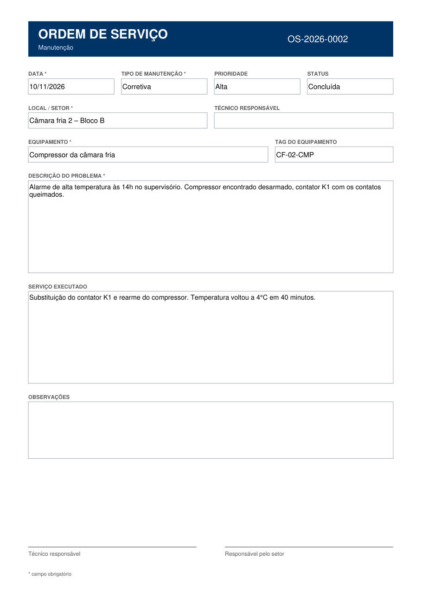

# 🛠️ OS Automática

Transforma o relato informal de um técnico de manutenção em uma **ordem de serviço em PDF**, usando o **Claude Code** com uma **skill** e um **hook**.

> "câmara fria 2 alarmou alta temp às 14h, compressor desarmado, troquei o contator, voltou pra 4°C"
>
> ↓ `/preencher-os`
>
> **OS-2026-0001.pdf**, preenchida e pronta para assinar



## 💡 O problema

Trabalhei como técnico de automação monitorando câmaras frias, freezers e salas climatizadas. Depois de cada atendimento vinha a parte chata: passar o que aconteceu para a ordem de serviço, campo por campo. O relato já existe (no WhatsApp, num bloco de notas, na cabeça do técnico), mas precisa ser reescrito à mão num formulário.

Este projeto automatiza essa etapa: a IA lê o texto livre, separa os campos e o sistema gera o PDF.

## ⚙️ Como funciona

```
Relato em texto livre
      │
      ▼
Skill /preencher-os ── o Claude extrai os campos e pergunta o que faltar
      │
      ▼
saida/dados.json
      │
      ▼
Hook (PreToolUse) ── confere os dados ANTES de gerar o PDF
      │                 faltou campo obrigatório? bloqueia e manda perguntar ao usuário
      ▼
scripts/preencher-os.js ── preenche o modelo com pdf-lib
      │
      ▼
saida/OS-2026-0001.pdf
```

- **Skill** (`.claude/skills/preencher-os/SKILL.md`): ensina o Claude a extrair só o que está no texto, converter datas ("hoje", "ontem") e perguntar pelos campos obrigatórios.
- **Hook** (`.claude/settings.json` + `scripts/validar-os.js`): uma rede de segurança. Mesmo que a IA tente gerar a OS com dados faltando ou inválidos, o hook bloqueia o comando e devolve a lista do que falta. **A IA não pode inventar o local ou o equipamento de uma OS.**
- **Validação** (`src/validar.js`): campos obrigatórios, data em DD/MM/AAAA (inclusive datas que não existem, como 31/02), valores permitidos e normalização ("Média" → `media`).
- **PDF** (`src/modelo.js`, `src/preencher.js`): o modelo do formulário é gerado por código, com campos de formulário de verdade (AcroForm). Depois de preenchido, ele é "achatado" para virar um documento final.

## 🧪 Testes

25 testes automáticos com o test runner nativo do Node (`node:test`), cobrindo validação, numeração, geração do PDF e o hook (inclusive executado como processo, do jeito que o Claude Code chama).

```bash
npm test
```

## ▶️ Como usar

Requisitos: [Node.js](https://nodejs.org) 20+ e [Claude Code](https://claude.com/claude-code).

```bash
npm install
npm test
```

Abra o Claude Code **nesta pasta** e use a skill:

```
/preencher-os Câmara fria 2 do bloco B alarmou alta temperatura hoje às 14h...
```

Há relatos de exemplo em `exemplos/`. O `03-faltando-dados.txt` mostra o Claude perguntando o que falta.

Também dá para gerar uma OS sem IA, a partir de um JSON:

```bash
node scripts/preencher-os.js saida/dados.json
```

## 📁 Estrutura

```
.claude/
├── settings.json              # registra o hook
└── skills/preencher-os/       # a skill
src/
├── campos.js                  # lista única de campos (validação, PDF e skill usam a mesma)
├── validar.js                 # regras de validação
├── modelo.js                  # desenha o formulário em branco
├── preencher.js               # preenche e achata o PDF
└── numero-os.js               # numeração OS-AAAA-NNNN
scripts/
├── preencher-os.js            # linha de comando: JSON → PDF
├── validar-os.js              # o hook
└── criar-modelo.js            # salva o modelo em branco em modelo/
tests/                         # testes automáticos
exemplos/                      # relatos fictícios
```

## 🧠 O que pratiquei

- Criar **skills** e **hooks** no Claude Code e entender quando usar cada um: a skill orienta a IA, e o hook garante a regra mesmo se a IA errar.
- Separar o trabalho da IA (entender texto) do trabalho do código (validar e gerar o documento).
- Gerar e preencher PDFs com formulário usando **pdf-lib**.
- Testes automatizados com `node:test` e TDD.

## 🚀 Próximos passos

- Versão web: colar o relato numa página e baixar o PDF, usando uma API de LLM (ex.: Gemini, que tem camada gratuita).
- Ler fotos de anotações à mão.

---

Todos os dados dos exemplos são fictícios.
